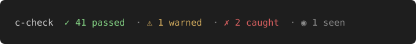

# c-check

[](https://github.com/pianburp/c-check/actions/workflows/ci.yml)
[](LICENSE)


Trust what [Claude Code](https://claude.com/claude-code) just did.



c-check checks every edit, command and finish. It blocks, warns, or sends Claude back when a rule fails.
Rules are code, not text in `CLAUDE.md`, so Claude cannot talk its way past them.
One mod, no runtime dependencies, no daemon, no build step.

## Install

In Claude Code:

```
/plugin install c-check --marketplace pianburp/c-check
```

Answer `y` to add the marketplace, then pick a scope. No config file needed: safe defaults apply.
Needs `git` on `PATH`.

## What it catches


186 recorded cases (112 cheats, 74 clean) were replayed through the rules, with no model calls.
The chart leaves out the model-based `judge-special-cases`, which is off and not measured.
Real-session and live-log numbers will be added after more sessions are recorded.

Limits: lab cases are small sample projects, written by the person who wrote the rules. [Method and full numbers](docs/reference.md#proof).

Check it against your own past sessions. It prints counts only, never their content:

```sh
node proof/replay-sessions.ts
```

## What you get

- **Tests pass before done:** Claude is sent back with the failing test output.
- **No test cheating:** deleted, skipped, narrowed or rewritten-to-fit tests send Claude back.
- **No outside edits:** blocks writes outside the project, after `..` and symlinks.
- **Risky command guard:** `git push --force`, `git reset --hard`, `DROP TABLE`, `curl … | sh`.
- **Secret guard:** warns with the line number of a likely key in a file.
- **Leak guard:** sends Claude back when a login page leaks personal data to a logged-out visitor, and holds deploys until that check passes.

The first three are on from the start. The rest start in `observe`: they log what they would do, and Claude sees nothing.
Switch one to `enforce` when you agree with its catches in `c-check report`.
See the [full reference](docs/reference.md).

## License

[MIT](LICENSE)
