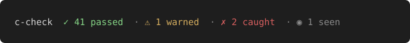

# c-check

[](https://github.com/pianburp/c-check/actions/workflows/ci.yml)
[](LICENSE)

**Verify coding-agent changes with c-check.** c-check runs your project's tests and checks the Git diff for deleted, skipped, or narrowed tests. Run it as a standalone check in Codex worktrees and CI, or install the Claude Code plugin for live checks during edits, commands, and turn completion.

## Get started

### Codex and CI (standalone)

The Codex setup today runs from a c-check checkout. A c-check plugin for Codex is still planned, and live hooks are at the capability-probe stage. [Codex guide](docs/codex.md)

Use Node.js 24 and Git. Install the target project's test dependencies, then run this command from the c-check checkout.

```sh
node src/cli/c-check.ts verify --base BASE_REF --project PROJECT_DIR
```

Replace `BASE_REF` with the commit from the start of the task or the PR merge base. Set `PROJECT_DIR` to the worktree you want to check. The verifier includes untracked files that Git does not ignore and preserves your staging area. It returns `0` for a pass, `1` for an enforced finding, or `2` for incomplete verification.

### Claude Code

Use Claude Code v2.1.290 or later and Git on `PATH`. Run this command in Claude Code.

```
/plugin install c-check --marketplace pianburp/c-check
```

Answer `y` to add the marketplace, then pick a scope. The plugin starts with default rules and shows their results in the status line. [Claude Code guide](docs/reference.md)



## What it checks

Both paths run these rules by default.

- **Tests pass before done.** Runs the configured test command or detects `npm test` from the project.
- **No test weakening.** Flags deleted, skipped, or narrowed tests and changes that weaken check settings.

The Claude Code plugin also blocks writes outside the project by default, after resolving `..` and symlinks. The checks below start in `observe` mode and record findings in the local log.

- **Risky commands.** Flags commands such as `git push --force`, `git reset --hard`, `DROP TABLE`, and `curl … | sh`.
- **Secrets.** Flags likely credentials in files with line numbers.
- **Data leaks and deploys.** Checks configured routes for personal data visible to logged-out visitors. The deploy gate can require a passing leak check before a deploy.
- **Claim and test checks.** Compares reported edits with the Git diff, flags unrequested tests, and runs original tests against the new code.

Review plugin findings with `c-check report` and set a rule to `enforce` when you want it to act on findings. By default, the plugin asks for human review after three consecutive send-backs from a single rule. If a check crashes in the plugin, the session can continue. [Rules and settings](docs/reference.md)

## Proof


186 recorded cases (112 cheats, 74 clean) were replayed through the rules, with no model calls. CI repeats the replay on every PR and fails if a score gets worse.

The chart leaves out the model-based `judge-special-cases`, which is off by default and not yet measured.

### Benchmark scope

- The rule author wrote the small sample projects. The benchmark uses held-out sets to measure how well the rules generalize.
- Results on real work and an on/off comparison are not published yet.
- Disguised cheats can get through. The known misses are [listed by rule](docs/reference.md#rule-scores-cheat-suite).

To replay your Claude Code sessions, run the command below. The output contains counts and positions.

```sh
node proof/replay-sessions.ts
```

## What it runs, reads and sends

c-check needs local access to do its job. Everything it runs is listed here.

| Program | Used by | Why |
| :- | :- | :- |
| `git` | End-of-task rules | Compares the worktree with a baseline using a private index. The plugin adds a `refs/c-check/<session>` ref, and `tests-still-bite` makes a temporary worktree outside the project. |
| Your test command | `tests-pass-before-done`, `tests-still-bite` | Runs `command` from `c-check.config.json`, or `npm test` when `package.json` has a real `test` script. |
| `node` | `tests-still-bite` | Finds the temp folder and links `node_modules` into the temporary worktree. |
| `curl` | `no-data-before-login`, only if configured | Requests the pages you list, on `127.0.0.1` only. |
| `claude -p` | `judge-special-cases`, off by default | Sends the session's source diff for review through your own Claude Code. |

**Network use.** By default, c-check keeps verification local. If you enable `judge-special-cases`, the plugin sends the source diff through your Claude Code configuration. Your test command follows its own network behavior.

**Personal data.** The leak guard reads responses from your local dev server and logs counts of emails, phone numbers, and ID numbers.

**Prompts.** The Claude Code plugin keeps prompts in memory for the session to tell whether you requested test changes.

### Files written

- The plugin writes `.c-check/logs/<date>-<session>.jsonl` with findings such as line numbers, file names, and rule IDs. Add `.c-check/` to your `.gitignore`.
- On Windows, the plugin writes `.c-check/run-tests.cmd` to run your test command. Standalone verification uses a temporary command file.

## Support

Report bugs with your OS, client version, and c-check version. For standalone verification, include your Node.js version. [GitHub issues](https://github.com/pianburp/c-check/issues)

## License

[MIT](LICENSE)
